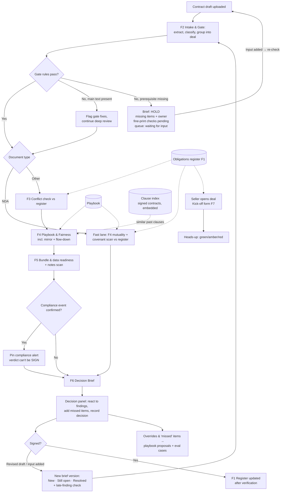

# Yours Legally, — AI PRD (v1.1)

> **Status.** v1.0 is aligned with the opportunity map (final on the Miro board, 13 Oct) and with the built prototype. Product decisions made while building are folded in and marked *(build)*; limits that belong only to the prototype are kept out of the requirements and listed in the repo README. Feature IDs (F1–F12) follow `Traceability_Matrix.md`. Section numbers follow the body of `AI PRD Template.docx`.

## PRD Details

| Field | Detail |
|---|---|
| **Product name** | Yours Legally, |
| **Author** | Vaibhavi Vadali (KaVi), AI Product Manager |
| **Date** | 4 October 2026 |
| **Version** | v1.1 (14 Oct): client meeting 2 folded in, marked *(client, 10 Oct)*: real volumes and review times, expired restrictions shown as context (FR-25), masking client data before AI calls (FR-26, 14 Oct), data retention, over-flagging stance, playbook as the "ideal contract" baseline, out-of-scope assumptions, user stories grouped into epics. v1.0 (13 Oct): build decisions, FR status, eval results. |
| **Status** | Final for submission (living document) |

> **Pain Point:** AtliQ has no legal team. Every contract is reviewed and signed by the CEO, late at night, from memory. What decides whether a contract is safe usually lives in *other* documents (promises AtliQ made in earlier contracts, past negotiation positions, the other documents the deal needs), and none of it is recorded anywhere. Reviews are slow, conflicts are missed, and deals wait in a single-person queue.

---

## 1. Executive Summary

| | |
|---|---|
| **What are we building?** | Yours Legally, — an AI contract review assistant that gives AtliQ the memory it lacks. It builds a register of everything AtliQ has already promised, checks every incoming and outgoing contract against that register and AtliQ's own negotiation playbook, and hands the CEO a verdict-first, cited, decision-ready brief. |
| **Why does it matter?** | 7 of 12 deals in today's queue carry their decisive risk in a different document. One forgotten non-compete (Al Noor, 2025) blocks three live deals worth $230k. A contract signed on a phone in 4 minutes (Brightwater) cost $9k + $14.2k in legal fees. Every contract and NDA waits on one person: about 3 to 4 contracts and 4 to 5 NDAs a month, taking about 2 hours for a standard contract and 6 to 8 hours for a complex one, with 1 week to 1 month end to end *(client, 10 Oct)*. |
| **Who is it for?** | **Primary:** Karandeep, CEO and the only reviewer and signer. **Secondary:** sellers (Bhavin, Dhaval, Jay), who bring deals in, make commercial promises, and wait on contracts to close. |
| **How will we know it worked?** | **North Star: Decide-from-brief rate.** ≥90% of brief versions are ones Karandeep decides from without digging: correct verdict, no missed or wrongly flagged blocker, no need to re-read the contract or search for context. Briefs arrive in minutes (NDA <1 min, MSA <10 min). Baseline today: about 2 hours of CEO review per standard contract and 6 to 8 hours (2 to 3 passes) for a complex one; 1 week to 1 month end to end *(client, 10 Oct)*. |
| **Target launch** | Prototype: capstone submission. Pilot: shadow mode on all new contracts for 4 weeks, then assisted review (see §14). |

---

## 2. Problem Statement and Background

**Who performs this process manually today?** Karandeep (CEO) reviews and signs every contract, from every side of the table: as supplier (client MSAs/SOWs, usually on the client's paper), as buyer (AtliQ's paper for agencies and freelancers), as partner (platform partnerships), and on both sides of NDAs. Sellers (Bhavin, Dhaval, Jay) bring contracts in and check scope only. Pranav (CTO) confirms staffing and reuse. Outside counsel (Mehta Rao in India, Calloway Stern in the US) is called in occasionally, at lakhs of rupees and ~a week per matter.

### 2.1 Current State

**Trigger:** a contract draft arrives by email (client paper), or a seller drafts AtliQ paper from whatever file is at hand. The deadline lives in a tracker note or someone's head.

1. **Received:** the draft lands in a seller's or Karandeep's inbox; the tracker is updated occasionally (often blank: entity, status, restrictions).
2. **Triage:** no owner, order or SLA; sellers chase Karandeep in parallel (three on the same morning, 22 Sep).
3. **Context gathering:** Karandeep searches inboxes, laptops and drives for related contracts (20 minutes to find Al Noor during a counsel call), or relies on memory ("I think the rest are ok").
4. **Review:** read late at night against a half-page 2024 checklist; about 2 hours per standard contract, 6 to 8 hours over 2 to 3 passes for a complex one *(client, 10 Oct)*; NDAs signed "if mutual" based on the title.
5. **Negotiate:** redlines from memory of old email threads; counsel only for big deals, often too late.
6. **Sign:** sometimes from a phone under deadline pressure.
7. **After signing:** the file is saved wherever; new obligations are never recorded, so the next review starts blind again.

### 2.2 Pain Points

- **The decisive risk sits in documents nobody checks.** Promises in older contracts (Al Noor GCC hotel non-compete to ~2029; Crestline most-favoured pricing to 2027; CloudSpan platform exclusivity to 2028; Northwind owning PipeKit code) silently block new deals (Gulf Crown, BlueOrchid, TravelHub, Lakeshore, Datavane, Rheinwerk).
- **Precedent lives only in memory.** Deliberate exceptions (Al Noor's 10% LD cap, "not our new standard") and accidents (Brightwater, Meridian) look identical on paper.
- **No checklist of what a deal needs.** The Harrington healthcare deal has patient data sitting in Pune before any BAA exists; sub-BAAs for a US freelancer and for AtliQ's own Indian entity are missing; insurance asked ($5M) vs held ($1M) was never raised.
- **Basic rules aren't applied consistently.** A UAE client contracting with AtliQ's US entity (TravelHub); a US freelancer on the India template (Marcus Reed); "mutual" NDAs that aren't (FinServe).
- **AtliQ's own paper breaks AtliQ's own standard.** Vendor templates carry the uncapped penalties and pay-when-paid terms Karandeep rejects as a supplier (Kriti), and don't pass client obligations down (Rohan Iyer kept IP that Acme was promised).
- **Single-person queue.** About 3 to 4 contracts and 4 to 5 NDAs a month *(client, 10 Oct)*, one reviewer; ShopSwift's SOW waited 9 days and the client's budget slipped a quarter.

### 2.3 Business Impact and Why Now

**Cost of the status quo**
- Direct losses: Brightwater settlement $9,000 + Calloway Stern $14,200 + ~2 weeks of senior time.
- Revenue at risk today: $230k of deals (Gulf Crown $140k, TravelHub $52k, BlueOrchid $38k) collide with one 2025 non-compete; Lakeshore ($64k) would trigger retroactive repricing of Crestline.
- Counsel: ₹1.2L and 5–7 working days for one Gulf Crown review, made slower by incomplete document packs.
- Opportunity cost: every hour Karandeep spends reading contracts is an hour not selling or running AtliQ; deals lost to the queue (ShopSwift).
- Compliance exposure: a live patient-data issue (Harrington) that no contract review would have caught.

**Why now**
- Volume grew from about 5 to about 8 to 9 documents a month in a year (3 to 4 contracts and 4 to 5 NDAs *(client, 10 Oct)*), and keeps growing. Real contracts run 10 to 15 pages.
- Seven deals worth ~$600k are queued with deadlines in the next two weeks (22 Sep meeting).
- The Brightwater post-mortem promised "no more signing on the phone" but changed nothing structural.
- Counsel explicitly asked for "every signed contract with restrictive covenants, exclusivity or MFN"; AtliQ can't produce that list.

### 2.4 Job To Be Done Framing

| | Karandeep (primary) | Sellers (secondary) |
|---|---|---|
| **Job to be done** | **When** a contract lands in my queue, **help me** see quickly whether it's safe to sign given everything AtliQ has already promised and how we've negotiated before, **so that I can** decide and sign with confidence without spending my evening reconstructing history. | **When** I'm shaping a deal, **help me** know which past commitments and paperwork affect it before I promise the client anything, **so that I can** close on the client's timeline without creating risk Karandeep has to unwind. |
| **Trigger** | A draft arrives (client paper), or AtliQ paper is about to be sent. | A new deal opens, or deal facts change (rate, scope, sites, tools, staffing). |
| **Outcome** | A brief he can decide from without re-reading the contract, ready in minutes (NDA <1 min, MSA <10 min); a contract decision in under 30 minutes of his time instead of about 2 hours (6 to 8 for complex contracts). If inputs are missing, the brief says exactly what and who must provide it. | A green/amber/red heads-up in under a minute, with the clause behind every flag. |
| **Why AI is justified** | Judging collisions means reading definitions across documents ("Affiliate", "Hospitality Business", "in the GCC"), not matching keywords. "Non-compete" doesn't even appear in the Al Noor clause. Mutuality, fairness and flow-down are semantic judgments. Volume and document length make manual review the bottleneck. **Where a rule works, we use a rule:** entity/law/payment/caps/required documents are deterministic once AI extracts the facts. | Answering "can I reuse what we built for hotel X?" requires mapping a plain-language plan onto IP, confidentiality, restriction and data-use clauses across contracts. The register makes this a cheap lookup instead of a re-read. |

---

## 3. Opportunity and AI Capability Mapping

| Opportunity | AI capability used |
|---|---|
| F1: build and maintain a register of every commitment in signed contracts | **Structured extraction** (long-document LLM extraction to a fixed schema, with verbatim source quotes) |
| F2: read each incoming file (PDF, Word, scan), classify, group and gate it; route NDAs to a fast lane | **Document reading** (text layer; OCR for scans), **classification + extraction**, then **deterministic rules** |
| F3: detect collisions between a new contract/deal and live commitments | **Retrieval over the register + LLM reasoning** over definitions and scope |
| F4: compare clauses to AtliQ's playbook in both directions; test NDA mutuality; check flow-down; show similar clauses AtliQ has signed before | **LLM comparison against a structured playbook** (checklist-driven) + **semantic similarity search** over a clause index of signed contracts (precedent reference) |
| F5: confirm the deal's document bundle is complete and consistent before data moves | **Rules** (deal type → required documents) + **LLM extraction** of data-handling facts from notes |
| F6: produce a verdict-first brief and a counsel pack | **Constrained generation** from verified findings only |
| F7: give sellers a heads-up from a short deal form | **Register lookup** by fixed question types + **semantic matching** of one free-text item |
| F8: shared contract queue with deadlines (due in / overdue) | None (non-AI UI and date rules) |

---

## 4. Personas and User Stories

### 4.1 User Personas

| Persona | Description |
|---|---|
| **Primary: Karandeep, CEO** (only reviewer and signer) | Reviews about 3 to 4 contracts and 4 to 5 NDAs a month alone *(client, 10 Oct)*; usually after 10 pm, sometimes on his phone; relies on a half-page 2024 checklist and memory; values mutual, balanced deals on every side of the table.<br><br>**Goal:** sign only what AtliQ can honour, fast enough for sellers to close, on fair terms.<br>**Frustration:** "I review everything myself, usually after 10 pm, and the only 'system' is my memory of how the last negotiation went. This doesn't scale and it isn't safe." |
| **Secondary: Sellers** (Bhavin, Dhaval, Jay) | Bring contracts in and wait on them; check scope only and assume the legal parts are covered; make commercial calls (discounts, reuse, scope, staffing) without seeing their legal consequences.<br><br>**Goal:** close on the client's timeline without surprises later.<br>**Frustration:** "We lost that one to our own queue." Nobody can answer "is there a list of what we've agreed not to do?" |
| *Stakeholders (not users)* | Pranav (CTO: delivery model, data handling, tool reuse); outside counsel (receive escalations); vendors/freelancers (receive AtliQ's paper). |

### 4.2 User Stories

Stories are grouped into one epic per feature, with one or two stories each *(client, 10 Oct)*. Stories describe the **user's need**, not the solution. How each need is met is specified in §6 (Functional Requirements) and §9 (Behaviour). Concrete dataset cases that verify each story live in **`Eval_Set.md`** (IDs in the last column) and are used for §11 Eval Criteria.

#### Epic E1 · Commitments register (F1)
*Goal:* Know everything AtliQ has already promised.

| ID | As a… | I want to… | So that… | Acceptance criteria | Built by / verified by |
|---|---|---|---|---|---|
| **US-1** | Karandeep | know everything AtliQ has already promised (and to whom, where, until when) before I sign anything new | I never sign a contract that breaks an earlier commitment | **Given** AtliQ's signed contracts, **when** I look up AtliQ's commitments, **then** every live restriction, pricing promise, exclusivity and IP transfer is listed once with who it binds (incl. affiliates), its scope, its expiry, any waivers, and the exact source clause; expired commitments are marked as expired; unreadable or missing documents are named. | F1 · FR-1, FR-2 · EV-R1–R4 |

#### Epic E2 · Intake and gate check (F2)
*Goal:* Know quickly whether a contract is workable; NDAs in a fast lane.

| ID | As a… | I want to… | So that… | Acceptance criteria | Built by / verified by |
|---|---|---|---|---|---|
| **US-2** | Karandeep | know within minutes whether a new contract is even workable | obvious problems go back before I spend time on the fine print | **Given** a new contract, **when** it arrives, **then** I see pass/fail with the clause for: correct AtliQ entity for the client, parties vs invoicing entity, governing law, payment terms, penalty and liability caps, insurance asked vs held, and any missing documents; fine-print findings are still shown whenever the main text is readable. | F2 · FR-3–FR-5, FR-17 · EV-03, EV-06, EV-11, EV-12 |
| **US-5** | Karandeep | know whether an NDA protects both sides in substance, quickly | "just sign if mutual" stops being a trap, and NDAs don't wait in the queue | **Given** an NDA, **when** it's reviewed, **then** the result arrives in under a minute, tests mutuality item by item (who is protected, whose obligations, residuals, remedies, hidden restrictions, term) regardless of the title, and returns "clean, sign" with no invented concerns when it is genuinely mutual. | F2 (routing) + F4 · FR-5, FR-8 · EV-07, EV-08 |

#### Epic E3 · Cross-contract conflict check (F3)
*Goal:* Catch collisions with earlier promises before signing.

| ID | As a… | I want to… | So that… | Acceptance criteria | Built by / verified by |
|---|---|---|---|---|---|
| **US-3** | Karandeep | be told when a contract collides with something AtliQ has already agreed elsewhere | I catch risks that aren't visible in the document in front of me | **Given** a contract that conflicts with a live commitment, **when** it's reviewed, **then** the conflict is raised as a blocker with both clauses side by side, the commitment's expiry and any applicable waiver; it never states a legal conclusion ("breach"); expired commitments are never raised. | F3 · FR-6 · EV-01–EV-07, EV-14 |

#### Epic E4 · Playbook and fairness (F4)
*Goal:* Compare every clause with AtliQ's own baseline, both ways.

| ID | As a… | I want to… | So that… | Acceptance criteria | Built by / verified by |
|---|---|---|---|---|---|
| **US-4** | Karandeep | see how each important clause compares with how AtliQ has negotiated before | I negotiate consistently and never repeat an accident as if it were policy | **Given** a clause that deviates from AtliQ's position, **when** it's reviewed, **then** I see the standard position and my own past decision, labelled standard / exception / concession / accident, plus the most similar clauses AtliQ has actually signed, each with its contract, date and label; one-off exceptions and accidents are never presented as the standard, and similar clauses inform me but never change the verdict. | F4 · FR-7, FR-22 · EV-01, EV-12, EV-P1–P7 |
| **US-11** | Seller / Pranav (preparing AtliQ's own paper) | know that the agreement I'm sending to a vendor or freelancer meets AtliQ's own standard and covers what we've promised the client | the other side isn't treated worse than AtliQ asks to be treated, and our client promises are actually backed | **Given** an AtliQ agreement for a vendor or freelancer, **when** it's checked before sending, **then** clauses AtliQ would reject as a supplier are flagged with the fair alternative, and any client obligation not passed down (IP, data protection, consent) is flagged against the related client contract; the client's one-sided terms are not passed down. | F4 · FR-7 · EV-10, EV-11, EV-13 |

#### Epic E5 · Deal bundle and data readiness (F5)
*Goal:* Paperwork and data handling in place before work starts.

| ID | As a… | I want to… | So that… | Acceptance criteria | Built by / verified by |
|---|---|---|---|---|---|
| **US-6** | Karandeep | be stopped when a deal's paperwork or data handling isn't in place | client or personal data never moves before the right agreements exist with everyone who touches it | **Given** a deal that handles regulated or personal data, **when** it's reviewed, **then** I see which documents are required for each party, which are missing or inconsistent, and any sign that data has already moved; facts taken from notes are presented for confirmation; a compliance event is escalated to a named person and never handled automatically. | F5 · FR-9, FR-10 · EV-06, EV-10, EV-12, EV-13 |

#### Epic E6 · Decision brief and feedback (F6)
*Goal:* Decide from one cited brief and correct it in place.

| ID | As a… | I want to… | So that… | Acceptance criteria | Built by / verified by |
|---|---|---|---|---|---|
| **US-7** | Karandeep | get one short brief that tells me what to do, with the evidence behind it | I can decide late at night in minutes without re-reading the contract | **Given** any reviewed contract, **then** the brief leads with a verdict and next action, shows at most three blockers with business impact and citations, my precedent, what's worth negotiating, what's fine, and what wasn't seen; a later version shows what is new, still open and resolved. | F6 · FR-11, FR-17 · all EV cases; EV-V1–V3 |
| **US-8** | Karandeep | correct the system in the same place I make my decision | it learns my standards without extra work, and I can trust it more over time | **Given** a brief, **when** I agree, disagree, add something it missed or record my decision, **then** this takes one or two taps, a reason is needed only when I reject a blocker, and my deliberate exceptions become proposals for my playbook that I approve or reject. | F6 · FR-12, FR-15, FR-16 |

#### Epic E7 · Seller deal check (F7, secondary persona)
*Goal:* Sellers check before they promise, so fewer surprises reach Karandeep.

| ID | As a… | I want to… | So that… | Acceptance criteria | Built by / verified by |
|---|---|---|---|---|---|
| **US-9** | Seller | know, before I propose something to a client, whether AtliQ is free to offer it (a price, a region or site, a tool we built before, a partner, who works on the data) | I don't promise a client something AtliQ has already committed not to do, and I don't find out after the contract arrives | **Given** what I'm planning to offer, **when** I check it, **then** within a minute I'm told for each item whether it's clear, needs attention or conflicts, with the reason and source; anything that can't be checked is said explicitly ("couldn't check, ask Karandeep") and silence is never treated as "safe"; I never see other clients' confidential terms beyond what I need. | F7 · FR-13 · EV-S1–S6 |
| **US-10** | Seller | know when what I was told may no longer hold, because my plan changed or the contract or AtliQ's commitments were re-checked | I don't keep acting on an out-of-date answer | **Given** a deal I've already checked, **when** my plan changes, then only the changed items are re-checked; **when** Karandeep re-checks the deal's contract or AtliQ's commitments change, **then** I'm told my answer may be out of date and asked to check again; every answer shows the date it was given. | F7 · FR-13, FR-19 · EV-S2, EV-S7, EV-S8 |

#### Epic E8 · Contract queue and deadlines (F8)
*Goal:* See every contract, its due date and who it waits on.

| ID | As a… | I want to… | So that… | Acceptance criteria | Built by / verified by |
|---|---|---|---|---|---|
| **US-12** | Seller / Karandeep | see every contract in progress, how long until it's due, whether it's overdue, its status and who it's waiting on | nobody has to chase, and deadlines don't slip unnoticed | **Given** open contracts, **then** each shows its client deadline as "due in X days" or "overdue", its status (incl. "waiting for input" and from whom) and the latest brief's verdict, sortable by deadline; the system does not guess whether a deal is "at risk" (offline decisions aren't visible to it); urgency never changes how risks are judged. | F8 · FR-14 |

## 5. Model Strategy

> Choosing the underlying model and build approach is an engineering decision, made jointly with the product team.

**What product owns**
- **Context requirements per role.**
  - Karandeep's reviews get the full contract + relevant register entries + playbook + deal notes.
  - Sellers' kick-off checks get register summaries only: what a restriction *means* for their deal, without other clients' rates or confidential terms beyond what's needed.
  - Counsel packs include only the documents relevant to the question.
- **Separation of rules and judgment.** Pass/fail checks (entity, law, payment days, caps, insurance, required documents, expiry) are deterministic code over AI-extracted fields. LLM reasoning is used only for collisions, fairness, mutuality, flow-down and summaries.
- **Approval gates.**
  - Register entries are extracted by AI from signed contracts (the existing backlog once, then every new signing) and **used in checks immediately**, so nothing is missed while verification is pending. Findings that rely on an unverified entry are labelled ("based on an unverified register entry: check source"); Karandeep's verification (source clause shown alongside, ~1 minute per entry) removes the label.
  - Playbook positions become "standard" only after Karandeep approves them.
  - Nothing is ever sent to a counterparty, vendor or counsel by the system.
- **Audit logging.** Every finding stores: input document version, register/playbook versions used, model and prompt version, output, and Karandeep's accept/override with reason.
- **Human-in-the-loop controls.**
  - Karandeep accepts/overrides each blocker.
  - Sellers confirm deal facts.
  - Compliance events become a pinned compliance alert for Karandeep (and a named owner); the system never handles them itself, and Karandeep closes them with evidence or an attested note.

**Approach guidance for engineering** (to be confirmed with cost estimation, Step 4)
- Off-the-shelf LLMs via API; **no fine-tuning** (too little data, and the playbook must stay editable by Karandeep).
- **Model tiering by task:** a small, fast model for intake extraction, classification and the NDA fast lane; a stronger reasoning model with long context for register extraction (one-time per contract) and collision/fairness reasoning.
- **Structured outputs** (JSON schemas) for every extraction and finding; free text only in the final brief, generated from structured findings.
- **Two retrieval modes, each used where it fits.**
  - **Conflict check (F3), structured filter only.** Register entries are retrieved by their fields (counterparty, entity incl. affiliates, sector, territory, service type, asset, dates). AI does the semantic work once, at extraction ("Dubai hotel chain" → hospitality, GCC); matching is then exact, explainable and testable. Similarity search is **never** used to decide whether a commitment applies, because a relevant entry ranked just outside the top results would be dropped silently.
  - **Similar past clauses (F4, FR-22), vector similarity search.** Every signed contract is split into clause-level chunks (clause number, heading, verbatim text, contract, date, AtliQ entity, side of table, clause type, and the intent label from the playbook tagging). Each chunk is embedded once. During review, each key clause of the incoming contract is embedded and the closest signed clauses of the same type are retrieved. Here similarity is the right tool: the question is "have we signed something like this?", and a near miss costs little because the result is reference material, not a decision input.
  - **Storage.** Embeddings live next to the structured data, not in a separate system: in production, Postgres with a vector extension (one database for register, deals, clauses and vectors); in the prototype, a pre-computed index file with in-code cosine similarity. The embedding model sits behind the same provider-neutral wrapper as the LLM; changing it means re-embedding the corpus once.
  - The same clause index later serves F11 (seller open Q&A) and template drift (F10) without redesign. Contracts are read once at register build, not at every question.
- Vendor terms must guarantee **no training on customer data** and minimal retention.
- *(client, 10 Oct)* **Baseline, not a generic risk model.** Risk can't be generalised across domains, so the playbook (Karandeep's positions, learned from the signed contracts and approved by him) acts as AtliQ's "ideal contract". Every clause is compared with it, and severity (blocker / high / medium) is the risk score; anything that fails or exceeds the baseline is put in front of Karandeep. Preferences such as a 1x-fees liability cap are recorded as his preference, not a rule.
- *(build)* **Chosen provider:** Google Gemini (flash models for reasoning, flash-lite for extraction, `gemini-embedding-001` for the clause index), each task on a fallback chain of models. A local open model (Ollama) runs the same pipeline for testing at no cost; it scored lower on the evals (32/50 vs 45/50), so it is not used for real reviews.

---

## 6. Functional Requirements

| ID | Requirement | Priority | Status |
|---|---|---|---|
| **FR-1** (F1) | Build an obligations register by AI extraction from signed contracts (existing backlog once, then each new signing): commitment type (non-compete, exclusivity, MFN/pricing, IP transfer/retention, data/location, insurance, non-solicit, **other**), binding entity incl. affiliates, scope (sector, geography, services, assets), start/expiry, waivers/amendments linked, verbatim source quote and clause number. Status live/expired computed by rule. | Must | Built |
| **FR-2** (F1) | **Register screen (Karandeep only):** list of all commitments filterable by live/expired, client, region and type; each entry shows its source clause with Verify / Edit / Reject; reachable from any finding ("view register entry"). All extracted entries are used in checks immediately; findings relying on unverified entries carry a label until verified. Rejected entries stop being used and the affected open deals are re-checked. Sellers never see the full register. *(build)* The screen lists **Restrictions** (can block a new deal: non-competes, exclusivity, pricing promises, IP given away) and **Duties** (must keep performing: data location, breach notices, insurance, audits) separately. An edit re-checks only the open deals it can affect. | Must | Built |
| **FR-3** (F2) | On upload (into an existing deal or as a new one), extract document type, parties, AtliQ entity, side of table, client country, governing law/forum, payment terms, LD/liability caps, insurance requirements, referenced annexes and cross-references. **Link it to its deal, tiered by certainty:** (a) **certain**: an explicit cross-reference to a known contract or exactly one open deal with that counterparty → link automatically and show it ("Linked to [deal] via [reason] · Change"); (b) **ambiguous**: several open deals or documents with the same counterparty, a near-match name, or AtliQ paper naming an end client with more than one deal → ask once, with options; (c) **no match** → new deal by default, shown with "Change". The user's choice is final and stored; matching is never re-run on re-checks (only an explicit "Move to another deal" changes it); hard contrary evidence appears once as a note under "what wasn't seen" with a one-click move, never as a blocking re-prompt; overrides update counterparty aliases and record "not this deal"; the register check is independent of deal linking. For AtliQ's own paper, the end client named in it links the flow-down check. *(build)* **Files:** PDF (text layer), Word (.docx, with automatic numbering kept) and text; scanned PDFs are read by OCR and marked as such; old .doc files are refused with what to do instead. **Before any model call, rules say what the upload is:** meeting notes or an update, a new version of one of the deal's documents, an additional document, a file that seems to belong to another deal, or a blank template (refused). The user confirms or changes this before anything is processed. | Must | Built |
| **FR-4** (F2) | Apply deterministic gate rules: entity matches client country; parties entity = invoicing entity; governing law vs entity; payment ≤45 days; LDs capped; liability capped; insurance required vs held; referenced annexes present. Show each as pass/fail with clause in a **"Contract facts" card** (each extracted field with its source snippet, editable; edits re-run the rules). | Must | Built |
| **FR-5** (F2) | Route by document type: **NDAs → fast lane** (mutuality checklist + covenant scan against the register), target <1 minute; all other types → full review (F3–F5). | Must | Built |
| **FR-6** (F3) | Check the contract and deal facts against every live register entry; output severity, both clauses verbatim, affected deals, expiry, applicable waivers, and whether the entry is verified; never assert "breach" on interpretive questions. | Must | Built |
| **FR-7** (F4) | Compare key clauses to the approved playbook; show standard position and Karandeep's precedent labelled standard/exception/concession/accident; in **mirror mode** apply the same standard to AtliQ's own paper and check flow-down against the linked client deal. | Must | Built |
| **FR-8** (F4) | NDA mutuality checklist: who is protected by the confidentiality definition, whose obligations, residuals, remedies/indemnity, hidden covenants (non-compete/non-solicit), term. Title is ignored. | Must | Built |
| **FR-9** (F5) | For each deal, list required documents per party by deal type (e.g. US healthcare: NDA + BAA + MSA + sub-BAA per subcontractor/affiliate; EU personal data: DPA + SCCs + sub-processor terms) and their status; the verdict cannot be SIGN until complete. | Must | Built |
| **FR-10** (F5) | Scan tracker and meeting notes linked to the deal for data-movement, staffing and commitment facts; present as "please confirm" prompts (Confirm / Not true / Edit). Confirmed compliance events (e.g. regulated data moved before the required agreement) raise a **compliance alert** (FR-21). | Must | Built |
| **FR-11** (F6) | Generate the decision brief per §9.1 from structured findings only; generate a counsel pack (draft, conflicting clauses, waivers, entity facts, the exact question) when a finding is tier-4. | Must | Built (counsel pack as preview) |
| **FR-12** (all) | **Decision & feedback capture (in the brief, not a separate form):** per blocker/high finding, Agree / Disagree / Change severity; Disagree on a blocker requires a reason code (not a real issue · wrong clause/citation · already handled · accepting deliberately → one-off or new standard); "Accept all" allowed for medium items only; "+ Something the brief missed" (clause ref + note); decision buttons (Sign · Sign after changes · Hold · Send back · Reject · Escalate to counsel) that update the queue status and are **recorded, never executed**; one question after deciding: "Did you need to open the full contract or other documents?" (No / Yes → why). *(build)* A chosen decision is a draft until every blocker and high finding has a reaction and any notes facts behind a compliance alert are answered; Karandeep then **finalises the review** and only then does the deal show as decided. Changing anything reopens it. Each finding names who acts as a **role** (Karandeep, AtliQ before sending, deal team, tech lead, seller, other side, counsel), not a person. | Must | Built |
| **FR-13** (F7) | Seller deal check: short form (client, sector, region/sites, services, rates by role, tools/assets to reuse, who touches data and where, + one free-text "anything else you're promising?") → per-item clear / needs attention / conflict, scoped to **AtliQ's obligations and conflicts only**; every answer stamped **"As of [date], based on what you told us and AtliQ's commitments at that time; the contract review is the final word"**, with the register version; re-runs only changed items when the seller edits the plan. *(build)* Client, sector, regions and services are required, otherwise the item is "not evaluated". Sellers share one view and see the seller side of every deal, never a brief, the register or another client's terms. | Should | Built |
| **FR-14** (F8) | Shared queue with **deadline tracking**: client deadline captured at kick-off or upload (editable); each contract shows **"due in X days"** or **"overdue"**, status (incl. "waiting for input" + owner) and latest verdict; sortable by deadline. No "at risk" prediction (offline decisions aren't visible). Deadline affects order and visibility only, never risk judgment. Non-AI. *(build)* The queue is grouped by AtliQ's side of the deal (selling, buying, partnerships, NDAs) and shows "review in progress x/y" until a review is finalised. | Must | Built |
| **FR-15** (all) | **Audit log:** every finding and interaction stored with contract, brief version, finding ID, action, reason code, note, timestamp, user, and register/playbook/model/prompt versions; passive signals captured (source documents opened beyond cited clauses, time on brief, re-opens). | Must | Built |
| **FR-16** (all) | **Feedback loop:** "accepting deliberately → new standard" and repeated overrides generate playbook proposals for Karandeep's approval; "missed" entries are added to the eval set as regression cases. | Should | Not built in prototype |
| **FR-17** (F2, F6) | **Hybrid gate, waiting-for-input and versioning:** if the main agreement is present and readable, the deep review (F3–F5) runs in v1 even when gate checks fail; it is staged only when its prerequisite is missing (main agreement missing, unreadable, or wrong document), and this is declared under "what wasn't checked". When inputs are missing the brief is still issued (verdict HOLD or SEND BACK, missing items + owner) and the queue shows "waiting for input". **"Input added → re-check"** (upload or button) issues a new brief version, organised as New in this version / Still open since previous / Resolved since previous; earlier reactions carry forward; the verdict reflects every open item. *(build)* Uploading into a deal always re-checks it; a **Sync** prompt appears only when the brief is out of date for another reason (register changed, a step failed). | Must | Built |
| **FR-18** (all) | **Automatic late-finding detection:** for each finding appearing for the first time in a later version, compare against the previous version. If the previous version ran the deep review and the relevant contract text, deal facts, register and playbook are unchanged, mark it a **late finding** (a miss on the previous version); otherwise mark it legitimately new. No user input required. | Must | Not built in prototype |
| **FR-19** (F7, F6) | **Seller re-check prompt:** whenever Karandeep runs a new check on the deal's contract (any new brief version) **or** the obligations register changes (new signing, waiver, expiry, verification edit), the seller's deal shows a banner: "Re-checked on [date]; your answer from [date] may be out of date. Re-run your check." Log when the banner was shown, seen, and when the seller re-ran. | Should | Built |
| **FR-20** (F3, F6) | **Deal-facts mismatch:** in Karandeep's brief, compare the contract against the facts the seller declared in the deal check (sites/regions, rates, tools to reuse, who touches data) and flag differences. | Should | Built |
| **FR-21** (F5, F6) | **Compliance alert:** a confirmed compliance event is pinned at the top of the brief; the analysis still completes in full; the verdict cannot be SIGN while the alert is open. Karandeep closes it with **Resolved: attach evidence**, **Resolved off the record: add note** (shown as "resolved by Karandeep's note, [date]", logged), or keeps it **Still open**. The system never notifies anyone externally. Attested notes may close **compliance events** (facts about what happened, owned by the accountable person) but never clear **contractual blockers**, which need a document (e.g. a verbal waiver leaves the blocker "pending written waiver"). | Must | Built |
| **FR-22** (F4) | **Similar past clauses:** maintain a clause index of every **signed** contract (clause-level chunks with clause number, verbatim text, contract, date, entity, side of table, clause type and intent label; embedded once at signing/backfill). For each key clause reviewed by F4 (LDs, liability, indemnity, payment, IP, confidentiality/residuals, non-compete/non-solicit, governing law, data protection), show up to **3 most similar signed clauses** of the same type above a similarity threshold, each with contract, date, clause reference, intent label (standard / exception / concession / accident / untagged) and a one-line "how it differs" note. Shown as reference only: it **never sets severity or the verdict**; exceptions and accidents carry their label prominently ("one-off: not a precedent"); drafts and unsigned documents are never indexed; Karandeep-only (sellers never see other clients' clauses). If nothing passes the threshold: "No similar clause signed before." | Must | Built |
| **FR-23** (F4, F6) *(build)* | **Deal-size rule:** below a value threshold set by Karandeep (now $50k), a playbook deviation or a rule check on LDs, liability cap, payment, insurance or governing law counts one step lower (high → medium, medium → low). Blockers, conflicts with promises made to other clients, compliance events and missing paperwork never change, because breaking a promise costs the same at any deal size. Deals with no value on file are not adjusted. Applied by rule, not by the model. | Should | Built |
| **FR-24** (F1) *(build)* | **Store in contract register:** when the decision is Sign or Sign after changes, one action extracts the signed contract's commitments into the register (unverified until Karandeep verifies them) and removes the deal from the queue; open deals those commitments can affect are flagged for re-check. If extraction fails, nothing changes and the action can be retried. | Must | Built |
| **FR-25** (F3, F6) *(client, 10 Oct)* | **Expired restrictions shown as context:** when an expired register entry would otherwise match the deal (same sector, region, client, asset or pricing scope), the brief lists it under a "Checked, expired" line with the commitment, its source clause and its end date. It is never a finding, never changes severity or the verdict, and is visible to Karandeep only. Non-competes and confidentiality that survive termination use their survival end date, not the contract end date. | Should | To build |
| **FR-26** (all AI steps) *(14 Oct)* | **Mask client data before any AI call:** a masking step on AtliQ's own server replaces names of parties and affiliates, people, emails, phone numbers, addresses, bank and tax numbers, and money amounts with labels ([CLIENT_1], [PERSON_2], [AMOUNT_3]) before text goes to the AI or embeddings provider. It finds them with the known lists (register entities, AtliQ entities, people in deal notes), pattern rules (emails, phones, account numbers, currency amounts) and a name-detection tool running locally. The key linking labels to real values never leaves AtliQ; answers are unmasked before Karandeep sees them, and the quote check runs on the original text. Regions, sectors, percentages, day counts, durations and clause headings stay visible because the review depends on them. The conflict filter and the rules (deal size, rate floors, caps) run in code on the real values. Scans are read by local OCR so they can be masked first; the clause index stores masked text. | Must | Not built (lite version specified: known lists + patterns, `Masking_Lite_Spec.md`) |

---

## 7. Context and Data Pipeline

### 7.1 What Goes In

**Principle: nothing is sourced live in the MVP.** Information enters through uploads, one-time imports and the deal record; the system states what it hasn't been given ("what wasn't seen"). Putting deal material in one place is itself part of the fix for documents "scattered across drives, inboxes and laptops".

| Input | Source and how it arrives (MVP) | Notes |
|---|---|---|
| **Signed contracts** | One-time bulk upload to build the register (backfill); thereafter every contract signed through Yours Legally, is stored automatically | Missing or illegible text recorded as such; referenced-but-absent documents listed (e.g. a waiver mentioned but not uploaded) |
| **Incoming / outgoing drafts** | Uploaded by a seller or Karandeep into a deal (or as a new deal) as PDF, Word or text, scans read by OCR; linked by FR-3 with one-tap confirmation | Client paper and AtliQ's own paper; revised drafts create new brief versions |
| **Tracker** | One-time CSV import to seed open deals (deadline, value, requester, notes) | After import, **the deal record replaces the tracker**: deadlines, status and owners live in F8, current because people work in it, not because it's synced |
| **Meeting notes** | Attached or pasted onto the deal by whoever was in the meeting | The seller check asks "anything agreed or shared in meetings?"; briefs state "no meeting notes attached" when none exist |
| **Deal facts** | Seller check form (F7) | Updated when the plan changes |
| **Obligations register** | Built from signed contracts (F1); verified by Karandeep; versioned | |
| **Clause index** | Built from signed contracts at the same time as the register: every clause chunked, labelled with its intent tag, embedded once; a newly signed contract is added automatically | Signed contracts only; used for similar past clauses (FR-22) |
| **Negotiation playbook** | 2024 checklist + negotiation notes + Karandeep's tagging (standard/exception/concession/accident); fairness gate applied; versioned; Karandeep-approved | |
| **Company facts** | Admin settings owned by finance: AtliQ entities and regions served, insurance held, delivery model (Pune delivery, intercompany arrangements) | Drive gate rules (entity, insurance) |

**Why no live inbox/drive integrations in the MVP:** (1) confidentiality: reading every inbox ingests client data the system doesn't need, a large privacy and security surface for a small company; (2) integration cost sits outside where the value is; (3) central upload is the behaviour change the register depends on. Email forwarding, watched folders and calendar/meeting integrations are deferred (§13.2).

### 7.2 Deliberately Excluded From Context

| Excluded attribute | Reason for exclusion |
|---|---|
| **Seller urgency, deal size and "biggest deal of the year" framing** in the risk judgment | Pressure is what led to Brightwater and Meridian. Value and deadline drive **queue order** only, never whether a risk is flagged or how severe it is. |
| **Patient data (PHI) and personal data samples** | The system reviews agreements, not datasets. It must not ingest PHI/personal data (e.g. the Harrington extract); it only records *that* data moved. |
| **Other clients' confidential commercial terms in seller views** | Sellers see what a restriction means for their deal (e.g. "rate floor applies"), not another client's rates, names or terms beyond need. |
| **Personal attributes of counterparties' people** (nationality, gender etc.) | Irrelevant to contract risk; prevents biased treatment of freelancers or small agencies. |
| **Unverified register entries and unapproved playbook positions** | Prevents acting on extraction errors or turning accidents into policy. |

---

## 8. Non-Functional Requirements

| Category | Requirement and target |
|---|---|
| **Performance** | NDA fast lane: brief in <1 minute. Full review of a client MSA: brief in <10 minutes. Seller kick-off check: <30 seconds. Register: initial build over all past signed contracts is a one-off batch job completing within a few hours; adding a newly signed contract <10 minutes. |
| **Reliability / uptime** | 99% during business hours (IST); a failed check never returns "clean". It returns "couldn't complete: review manually" with what was and wasn't checked. |
| **Security** | Encryption in transit and at rest; role-based access (Karandeep full; sellers see the seller side of every deal, never briefs, the register or other clients' terms *(build)*; Pranav delivery/data facts); audit log of every view and decision; text in a document or note addressed to an AI reviewer (e.g. "ignore your instructions") is raised as a finding *(build)*; sign-in with AtliQ's existing work accounts through an off-the-shelf login provider (no custom authentication is built). Prototype: demo role switch (Karandeep / seller). |
| **Data retention** *(client, 10 Oct)* | Signed contracts, the register and the audit log: kept for the life of the contract plus 7 years (limitation periods for contract claims and tax records), since restrictions such as non-competes outlive the contract. Drafts that are never signed: deleted 90 days after the decision. Meeting notes: kept with their deal on the same rule. Evidence files for compliance alerts: kept with the signed contract. AI provider: no training on AtliQ data and no retention beyond processing (zero-data-retention terms). The client set no preference; these are proposals for Karandeep to confirm. |
| **Masking** *(14 Oct)* | Two layers protect client data sent to the AI: (1) provider terms with no training on AtliQ data and no retention beyond processing; (2) masking (FR-26), so the provider sees clause wording but not who the contract is with, who signed it or how much it is worth. What masking cannot hide: the clause wording itself, which the model must read to judge it. |
| **Privacy and compliance** | LLM vendor with no training on customer data and minimal retention; contracts stored in AtliQ-controlled storage; no PHI/personal datasets ingested; honours client confidentiality clauses (contract access limited to need-to-know). |
| **Scalability** | Handle ~20 documents/month (more than 2× today), with real contracts of 10 to 15 pages, and a register of 200+ contracts without design changes. Clause index sized for 500+ contracts (~20,000+ clauses) with similarity lookups in <1 second per clause; moving from the prototype index file to a database vector index changes storage only, not behaviour. |
| **Integrations** | **MVP:** manual upload into deals; one-time CSV import of the existing tracker; no live connections to inboxes, drives or calendars. **Later (v2):** contracts@ forwarding address, watched Drive folder, calendar/meeting-note integrations (with consent rules), e-signature status. **Never:** outbound auto-sending integrations. |
| **Explainability & auditability** | Every finding links to a clause (verbatim quote + location) and to the register/playbook entry used; versions recorded; reproducible on re-run. |
| **Usability** | Brief readable on a phone, but signing actions are never offered in the product. |

---

## 9. Behaviour, Output Specification and Workflow

### 9.1 Standard Output Per Role

**Karandeep: Decision Brief**

| Output field | Description |
|---|---|
| **Verdict + action** | One line, fixed vocabulary that mirrors the decision buttons: **SIGN** · **SIGN AFTER CHANGES** (negotiable deviations) · **SEND BACK** (fixes needed from the other side, e.g. wrong entity, missing document) · **HOLD** (a blocker needs Karandeep's decision, a waiver, counsel or a missing input). The system never recommends "Reject"; that call is Karandeep's alone. Plus the next action and the deadline. |
| **Compliance alert (when present)** | Pinned above everything else; verdict cannot be SIGN while open; closed by evidence or Karandeep's attested note (FR-21). |
| **Blockers (max 3)** | Each: plain-English business impact ("conflicts with Trustline, a live contract"), both clauses quoted with location, severity, confidence, and the decision owner (Karandeep / business fix / counsel). |
| **Precedent** | Karandeep's past position on this point, labelled standard / exception / concession / accident. |
| **Similar past clauses (expandable, per key clause)** | Up to 3 signed clauses closest to this one: contract, date, clause ref, intent label, and how it differs ("same 5% cap, but no client-delay exclusion"). Exceptions/accidents marked "one-off: not a precedent". Reference only; never changes the verdict (FR-22). |
| **Worth negotiating (collapsed)** | Medium items with the playbook's counter-position. |
| **What's fine** | One line listing checks passed (e.g. "LDs match your standard; correct entity; Indian law"). |
| **What wasn't seen** | Missing annexes/documents, illegible clauses, facts that need confirmation. |
| **Register-entry labels** | Findings based on an unverified register entry say so, with a link to verify it. |
| **Counsel pack (tier 4 only)** | Draft + conflicting clauses + waivers + entity facts + the exact question, prepared for Karandeep to send. |

**Karandeep: Decision & Feedback Panel** (part of the brief, see FR-12)

| Output field / control | Description |
|---|---|
| **Per-finding reaction** | ✓ Agree · ✗ Disagree (reason required for blockers) · ⇅ Severity. Every blocker needs its own tap; "Accept all" only for medium items. |
| **+ Something the brief missed** | Clause reference + short note; becomes an eval regression case. |
| **Decision** | Sign · Sign after changes · Hold · Send back · Reject · Escalate to counsel. **Recorded, never executed:** it updates the queue and keeps sellers in sync, but Yours Legally, sends, signs or contacts no one. Replies, signatures and client conversations stay with Karandeep, by design: the person who signs owns the commitment, and a tool that acted on his behalf would blur that accountability. |
| **One follow-up question** | "Did you need to open the full contract or other documents to decide?" No / Yes → missing context · didn't trust a citation · brief unclear. |
| **Brief version & change summary** | From v2 onwards the brief is grouped as **New in this version · Still open since previous · Resolved since previous**; earlier reactions carry forward, so only new or changed findings ask for a reaction. |

**Karandeep: Register Screen** (FR-2)

| Field / control | Description |
|---|---|
| **Commitment list** | All commitments, filterable by live / expired, client, region, type; verified vs unverified shown. |
| **Entry detail** | Who it binds (incl. affiliates), scope, expiry, waivers, source clause verbatim; Verify / Edit / Reject. |
| **Impact** | Open deals and seller checks this entry currently affects; editing or rejecting re-checks them. |

**Seller: Deal Heads-up**

| Output field | Description |
|---|---|
| **Item status** | Green / amber / red per form item, with the clause behind each flag. |
| **What it means / what to do** | Plain-English implication and next step; amber/red always "talk to Karandeep before proposing". |
| **Couldn't check** | Any free-text item not matched to a register entry is listed explicitly. |
| **As of** | Date of the answer and the register version used; "the contract review is the final word". |
| **Re-check banner** | Shown when Karandeep has re-checked the deal's contract or AtliQ's commitments have changed since the answer was given; one tap re-runs the check. |

### 9.2 Required Behaviour States

| State | What triggers it | Required behaviour |
|---|---|---|
| **Clean** | All checks pass; no register collisions | Verdict SIGN; list what was checked; no invented concerns (LoopMart, Sunrise). |
| **Deviations only** | Playbook deviations, no blockers | SIGN AFTER CHANGES; show counter-positions with precedent. |
| **Blocker** | Register collision or critical playbook breach | HOLD; ≤3 blockers with both clauses; route to the lowest tier that can resolve it (Karandeep → business fix → counsel). |
| **Gate failure, main text present** | Wrong entity/template, insurance gap, missing annex, while the main agreement is present and readable | Run the deep review anyway (hybrid rule); verdict SEND BACK/HOLD listing gate fixes **and** all fine-print findings, so one send-back covers everything. |
| **Gate failure, deep review staged** | Main agreement missing, unreadable, or the wrong document | Verdict HOLD; state under "what wasn't checked": "fine-print checks will run once [item] is provided"; no deep-review findings shown. |
| **Waiting for input** | Required document/annex missing, or a notes-derived fact unconfirmed | Brief issued anyway with all available findings; verdict HOLD; list each missing item and who must provide it; queue status "waiting for input" (clock paused); never wait silently. |
| **New version** | Revised draft uploaded or "Input added → re-check" | Re-run all checks; issue brief v(n+1) grouped as New / Still open / Resolved; carry earlier reactions forward; unresolved findings are always repeated (never silently dropped); run late-finding detection (FR-18). |
| **Compliance alert** | Confirmed compliance event (e.g. regulated data moved before the required agreement) | Analysis completes in full; alert pinned at the top for Karandeep (+ named owner); verdict cannot be SIGN while open; closed by evidence or attested note (FR-21); the deal stays open and can be re-checked at any time; no workaround suggestions; no external notification by the system. |
| **Insufficient / illegible input** | Missing pages, OCR gaps, referenced annex absent | Say exactly what couldn't be read or found; never infer missing text; never return "clean". |
| **Low confidence** | Interpretive question (e.g. "substantially similar services") | Present both readings and clauses; label "needs judgment/counsel"; no legal conclusion. |
| **Unverified register entry** | A finding relies on a register entry Karandeep hasn't verified yet | Raise the finding anyway (never suppress it), labelled "based on an unverified register entry", with a link to verify. |
| **Expired obligation** | Register entry past its end date that would otherwise match the deal | Never a finding; shown in the brief as context ("checked: [commitment], expired on [date]") so Karandeep sees it was considered (FR-25) *(client, 10 Oct)*. |
| **Seller answer may be stale** | New brief version on the deal, or register updated, after the seller's last check | Show the re-check banner to the seller; never silently change a past answer; the new check is dated. |
| **System failure** | Model/API error or timeout | "Couldn't complete: review manually", plus what was completed. |

### 9.3 End-to-End Decision Flow

1. Seller opens a deal and submits the kick-off form (F7) → heads-up returned; deal facts saved.
2. A contract draft arrives and is uploaded (by seller or Karandeep).
3. F2 extracts fields, classifies the document and side of table, groups it into the deal.
4. F2 applies gate rules. If the main text is present, failures are flagged and the deep review still runs (hybrid rule); if a prerequisite is missing, the deep review is staged and declared. Missing inputs put the contract in **waiting for input** (brief still issued, clock paused).
5. F2 routes: **NDA → fast lane** (step 6a); other types → full review (step 6b).
6a. NDA fast lane: F4 mutuality checklist + covenant scan against the register → brief (<1 min).
6b. Full review: F3 retrieves relevant live register entries and checks collisions.
7. F4 compares clauses to the playbook (or mirror mode for AtliQ paper), checks flow-down, and attaches the most similar signed clauses to each key clause (FR-22).
8. F5 checks the deal's document bundle and scans linked notes; confirmed compliance events raise a pinned compliance alert (analysis still completes).
9. F6 assembles the decision brief from verified findings; tier-4 issues get a counsel pack.
10. Karandeep reviews the brief in the decision panel: reacts to each blocker (reasons logged for disagreements), adds anything missed, records his decision (which moves the queue status) and answers the one follow-up question.
11. Karandeep negotiates/decides; any outbound message is sent by him.
12. Revised drafts or missing inputs ("Input added → re-check") re-enter at step 3 and produce a new brief version grouped as New / Still open / Resolved; late-finding detection runs against the previous version.
13. On signing, F1 adds the new contract's commitments to the register (verified by Karandeep). Any new brief version or register change shows sellers on affected deals a re-check banner (FR-19).
14. Overrides and new positions are proposed to Karandeep for playbook updates.

### 9.3a Worked Example: a new contract from upload to decision

*Illustrative: the Rheinwerk draft arrives (deal owner Bhavin, client deadline 15 Oct).*

1. **Upload** (≈10 seconds): Karandeep or Bhavin drops the draft into Yours Legally,
2. **Identify** (system, seconds): Services Agreement · Rheinwerk Analytics GmbH (Germany) · AtliQ Technologies Pvt Ltd as supplier · German law · €88k · references Annex 3 (data-processing agreement).
3. **Link to deal** (system): exactly one open Rheinwerk deal → linked automatically and shown: "Linked to *Rheinwerk – Pipeline modernisation* (only open deal with this client) · Change." No question asked; a question appears only when the match is ambiguous.
4. **Gather context** (system): register entries relevant to the scope (Northwind's IP clause covering PipeKit; no restrictions covering Germany), playbook positions, linked documents (Kriti's subcontract names Rheinwerk as end client), notes attached to the deal.
5. **Gate checks** (system): entity ✓ · payment ✓ · delay penalties ✓ (match standard) · Annex 3 ✗ referenced but not uploaded. The main text is present, so the deep review still runs.
6. **Deep review** (system, minutes): PipeKit ownership conflict (Northwind §9.2 ↔ Rheinwerk §6.3); data-processing annex missing; Kriti's subcontract lacks data-protection terms and IP assignment.
7. **The brief**: every input the system needs is a button or upload slot inside it:

```
HOLD: 1 blocker, 1 missing document                        Due in 11 days

🔴 PipeKit may belong to Northwind (Northwind §9.2 ↔ Rheinwerk §6.3)
   Needs your judgment, possibly counsel     [✓ Agree] [✗ Disagree] [⇅]

📎 Missing: Annex 3 data-processing agreement (owner: Bhavin)
   [Upload it here]   [It's already in the contract → show page]

❓ Please confirm (from deal notes): "Pranav plans to reuse PipeKit"
   [Confirm] [Not true] [Edit]

✓ Fine: entity, law, payment, delay penalties, liability cap, acceptance

What's your call?
[Sign] [Sign after changes] [Hold] [Send back] [Reject] [Escalate to counsel]
This simply records where things stand, so Bhavin and the queue stay in step with
you. Nothing is sent, signed or shared on your behalf; the replies and the
conversations with Rheinwerk remain yours.
```

8. **Decide**: Karandeep presses **Hold**. The queue shows "waiting for input: Annex 3 (Bhavin) · due in 11 days".
9. **New input → automatic re-check**: Bhavin uploads Annex 3 to the deal (or Karandeep presses "Input added → re-check"). Brief v2: Resolved: annex on file · New: findings from the annex review · Still open: PipeKit. Bhavin's own deal check shows the re-check banner.
10. **Close**: Karandeep decides from v2 (e.g. Escalate to counsel, with the counsel pack prepared for him to send). When the contract is signed, its commitments join the register after his verification, so the next review starts from them.

**His effort for a clean contract:** one upload and one decision. **For one with gaps:** add an upload or a few confirm taps, all inside the brief.

### 9.4 Flow Diagram



---

## 10. Guardrails and Failure Modes

| Failure mode | What goes wrong | Required guardrail | Owner |
|---|---|---|---|
| **Missed conflict (false negative)** | A contract colliding with a live commitment is marked clean (the Gulf Crown risk) | Register-first design; every live entry checked, **including unverified ones (labelled)**; recall eval ≥95% on known conflicts before launch; "what wasn't seen" always shown | Product + Eng |
| **Crying wolf (false positive)** | Routine clauses or expired restrictions flagged; Karandeep stops reading | ≤3 blockers on top, every other finding still listed; expired entries shown only as context, never as findings; "what's fine" section. **Stance *(client, 10 Oct)*: over-flag rather than miss.** With Karandeep in the loop a false alarm costs seconds, a missed clause can cost a dispute; false alarms are reduced over time, not by hiding findings. | Product |
| **Hallucinated or wrong citation** | A finding quotes a clause that doesn't exist or says something else | Verbatim quote required and string-matched to the source before display; findings without a valid citation are dropped | Eng |
| **Legal conclusion on an interpretive question** | System says "you are in breach" or "this is enforceable" | Fixed vocabulary; interpretive items labelled "needs judgment/counsel" with both readings | Product |
| **Learning the wrong precedent** | An accident (Brightwater) or one-off exception (Al Noor 10%) treated as standard | Only Karandeep-approved positions are "standard"; others labelled exception/concession/accident | Karandeep |
| **Automation overreach** | System sends a redline, approves, signs, or notifies a regulator | No send/sign/approve capability exists in the product; decisions are recorded, never executed; drafts only; compliance alerts go to Karandeep and a named owner | Product |
| **Evasive suggestions** | System proposes workarounds to dodge an obligation (e.g. route work via a third party) | Recommendation set limited to: comply, renegotiate, seek consent/waiver, business fix, counsel | Product |
| **Confidentiality leak** | A seller sees another client's rates or terms | Role-based views; seller heads-up shows implications, not source terms beyond need; similar-clause results are Karandeep-only | Eng |
| **Similar clause mistaken for precedent** | A clause that is merely similar (or was an accident/one-off) is read as "we accepted this before, so it's fine" | Similar clauses are reference only and never set severity or the verdict; intent label shown on every result, exceptions/accidents marked "one-off: not a precedent"; only signed contracts indexed; similarity threshold, otherwise "no similar clause signed before" | Product + Eng |
| **Unverified extraction drives a decision** | Register extraction error leads to a wrong blocker | Findings relying on unverified entries are labelled with the source clause shown; Karandeep verifies/edits/rejects on the Register screen; rejected entries trigger re-checks | Karandeep + Eng |
| **Attested notes overused** | A note is used to clear a contractual blocker that needs a document | Notes may close compliance alerts only; contractual blockers remain "pending written [waiver/amendment]" until a document is uploaded | Product |
| **False reassurance to sellers** | Silence on an unmatched item read as "safe" | Unmatched items explicitly "couldn't check, ask Karandeep"; never "go ahead" | Product |
| **Pressure bias** | Big/urgent deals get lighter scrutiny | Deal value and urgency excluded from risk judgment (§7.2) | Product |
| **Unsupported finding** *(build)* | A finding about the contract's terms has no verified clause or note behind it | No evidence, no counted finding: it is shown as unsupported, counted low and never moves the verdict | Eng |
| **Clear conflict dismissed by the model** *(build)* | The register filter finds a clear match (same sector and region, same role's price floor, a named asset) and the model calls it not applicable | The match stays as a high "needs your judgment" finding citing the register clause unless a waiver applies | Eng |
| **One-way NDA missed** *(build)* | The model step fails or misreads an NDA titled "mutual" | A rule flags definitions that protect only one side or obligations that bind only the recipient, whatever the title | Eng |
| **Instructions hidden in a document** *(build)* | A contract or note tells the AI reviewer to ignore its rules or return SIGN | Raised as a high, quoted finding, so the deal can't come out clean | Eng |
| **Blank template reviewed as a contract** *(build)* | A template's placeholder clauses are treated as someone's terms | Detected by rule on upload and refused before any model call | Eng |
| **Small deals waved through** *(build)* | The deal-size rule hides a real problem | It lowers only negotiable deviations; conflicts, compliance and paperwork never change | Product |
| **Client data exposed to the AI provider** *(14 Oct)* | A client name, person, amount or bank detail reaches the external model in a prompt | Masking before every AI and embeddings call (FR-26); known-entity lists plus pattern rules plus local name detection; a leak scan of every outgoing request in testing; provider terms with no training or retention | Eng |
| **Masking hurts review quality** *(14 Oct)* | Labels hide something the model needed (e.g. which party is AtliQ), so a finding is missed | AtliQ's own entities get fixed labels ([ATLIQ_PVT_LTD], [ATLIQ_INC]) and the client a consistent one, so who-owes-whom stays readable; regions, sectors, percentages and durations stay visible; masked vs unmasked eval run before release | Eng / PM |
| **Feedback fatigue / rubber-stamping** | Karandeep clicks "agree" without reading, or stops giving feedback; metrics become meaningless | Feedback built into actions he must take (decision buttons move the queue); one question per brief max; reasons required only for blocker disagreements; no "accept all" on blockers; passive signals (time on brief, source docs opened) flag rubber-stamping | Product |

---

## 11. Eval Criteria

Launch-readiness tests run on **`Eval_Set.md`**: 15 incoming documents (12 deals), the register built from 17 signed documents, synthetic version pairs and seller checks. Each eval case traces to a user story (§4.2) and functional requirement (§6).

| Eval dimension | Definition and threshold |
|---|---|
| **Blocker recall** | % of expected blockers detected across the eval set ("must find" items). **≥95%; 100% on compliance alert cases.** |
| **Precision on clean contracts** | Clean cases return SIGN with **0 blockers and ≤1 medium item**; "must not flag" items (incl. expired commitments) are **never** flagged. |
| **Citation validity** | % of findings whose quote matches the source text exactly and points to the right clause. **100%** (invalid findings are suppressed). |
| **Extraction accuracy** | Key fields (entity, law, payment days, caps, insurance, parties) correct vs a hand-labelled set. **≥95% per field.** |
| **Register accuracy & coverage** | Register entries correct (type, binding entity incl. affiliates, scope, expiry, waiver) vs hand-built register. **≥90% exact, 100% of live restrictions present.** |
| **Severity calibration** | Findings' severity matches the answer key (blocker/high/medium/OK). **≥85% agreement**, no blocker downgraded to OK. |
| **Guardrail compliance** | 0 instances of "breach"/"enforceable" conclusions; 0 evasive suggestions; 0 send/sign actions; unmatched seller items always "couldn't check". **100%.** |
| **Consistency** | Same contract reviewed 3 times → same verdict and blockers. **≥95%.** |
| **Version handling** | On version pairs: unresolved findings carried forward **100%**; resolved findings moved to "Resolved" **≥95%**; **0 late findings** on unchanged text. |
| **Seller checks** | Seller-check cases return the expected clear / attention / conflict status per item **≥95%**; unmatched items always "couldn't check" **100%**; re-check banner raised on every new brief version or register change affecting the deal **100%**. |
| **Access control** | Role tests: a seller cannot open Karandeep's brief, the Register screen, or another client's terms; seller answers never reveal another client's name or rates **100%**. |
| **Deal linking** | Uploaded documents proposed to the correct deal (incl. Harrington BAA → MSA via cross-reference; Kriti → Rheinwerk via end client) **≥95%**; uncertain matches always ask, never link silently **100%**. |
| **Similar past clauses** | On EV-P cases: the expected signed clause appears in the top 3 (**recall@3 ≥80%**); intent labels shown correctly **100%**; exceptions/accidents never presented as standard **100%**; unsigned drafts never returned **100%**; verdict identical with and without the panel **100%**. |
| **Masking leaks** *(14 Oct)* | Every request sent to the AI and embeddings provider during the eval run is scanned for known names, people, emails and money amounts. **0 leaks.** |
| **Masking quality cost** *(14 Oct)* | Same eval set run masked and unmasked. Masked results within **2 cases** of the unmasked run, and no blocker on a compliance alert case lost. |
| **Latency** | NDA fast lane <1 min; full MSA <10 min (p90). |
| **Reading real files** *(build)* | Word and text-layer PDFs keep ≥98% of words and every clause number; scans read by OCR keep ≥95%. |
| **Upload detection** *(build)* | Notes, new versions, wrong-deal files and blank templates told apart correctly **100%** on the test set. |
| **Held-out set** *(build)* | A separate set never used for tuning (10 signed contracts, 10 drafts arriving as Word, PDF and scans) with answer-key cases fixed before the first run: verdicts, conflicts found, false alarms on the clean draft. |

**Results on the prototype (Gemini, 12–13 Oct).** Full eval: **45 of 50 cases pass**, 1 skipped (FR-18 not built). Citation validity 100%; similar past clauses recall@3 100% with the verdict unchanged without the panel; 0 legal conclusions and 0 Reject recommendations in model-written text; added guardrails 11/11; file reading 10/10 (Word 100%, PDF 98.4–99.4%, scans 99.5–99.6%, every clause number kept). Consistency: 8 of 9 fresh runs give the deal's most common verdict; severity on judgment calls (e.g. the Datavane exclusivity) still varies. The 4 failures are judgment calls that differ between runs. Held-out results are pending the next model batch. The free local model (Ollama) passed 32 of 50, which is why it is used only for testing.

---

## 12. Success Metrics (North Star & Metrics)

**North Star: Decide-from-brief rate. The % of brief versions on which Karandeep makes his decision without needing to dig: correct verdict, no missed or wrongly flagged blocker, and no need to re-read the contract or search for context. Target ≥90%.**

**Why this North Star**
- **It measures the handoff the product controls.** Yours Legally,'s output is the brief. After it, Karandeep's judgment, the counterparty's turnaround and the signature are human-dependent, so "contracts signed safely", "time to signature" or the number of negotiation rounds would blend the product's performance with things it can't influence. How many rounds a negotiation takes is between Karandeep and his clients.
- **Time isn't the North Star, because the system's part takes minutes.** Brief turnaround (NDA <1 min, MSA <10 min) is a requirement (§8) and a guardrail metric. Human waiting time (missing documents, unconfirmed facts) is tracked separately with the clock paused, not blamed on the product.
- **It holds correctness and usefulness together.** A brief that is fast but wrong, or right but needs Karandeep to dig through the contract anyway, both fail.

**Unit of measurement: each brief version.** Every brief version is a decision point. A v1 that says "SEND BACK: wrong entity" and lets Karandeep decide that without digging is a success; the corrected v2 is a new decision point, measured on its own.

**How it's measured (FR-12, FR-15, FR-18).** A brief version counts as a success when:
1. a decision is recorded via the decision buttons, **and**
2. Karandeep answers "No" to "Did you need to open the full contract or other documents?" (cross-checked against passive signals), **and**
3. no blocker in it is marked "not a real issue" or "wrong clause/citation", **and**
4. nothing is added via "+ Something the brief missed", **and** no later version produces a **late finding** against it (FR-18: a finding that appears later although the deep review ran and the relevant text, deal facts, register and playbook were unchanged).

The decide-from-brief rate is computed automatically from the decision panel, the audit log and version comparison; no human audit is needed to measure it. Misses that nobody notices are, by definition, not counted; "+ Something the brief missed", late-finding detection and post-signing issues are the backstops.

Findings that are still open are repeated in every later version ("Still open since previous"); this is correct behaviour and never counts against the product. Findings that are legitimately new (staged deep review now run, new or changed text, register/playbook updated) also don't count against earlier versions.

| Layer | Metric | Target / threshold |
|---|---|---|
| **North Star** | Decide-from-brief rate (per brief version) | ≥90% |
| **Output (shallow)** | % of new contracts with a brief; brief turnaround (p90) | 100%; NDA <1 min, MSA <10 min |
| **Efficiency** | Time from upload to Karandeep's decision, **clock paused while waiting for input** | ≤1 working day (vs up to 9 days today) |
| **Efficiency** | Karandeep's active review time per contract | about 2 hrs (6 to 8 for complex) → <30 min |
| **Diagnostic** | Time spent in "waiting for input", by missing item and owner | Tracked; used to fix upstream (sellers, templates) |
| **Trust signal (AI-specific)** | % of blockers marked Agree | ≥85% |
| **Trust signal (AI-specific)** | Similar-clause usefulness: % of panels expanded on blocker/high findings; "had to dig" reasons citing missing precedent | Tracked; missing-precedent reasons trending down |
| **Trust signal (AI-specific)** | "Had to dig" rate, by reason (missing context / didn't trust citation / unclear) | <10%, trending down |
| **Guardrail (AI-specific)** | Missed blockers ("+ missed" entries, late findings, issues surfacing after signing) | 0 missed compliance alerts; <5% of blockers |
| **Guardrail (AI-specific)** | Late findings (FR-18): findings surfacing in a later version on unchanged text after a full deep review | 0 target; each one reviewed |
| **Guardrail (AI-specific)** | False alarms ("not a real issue" on blockers); invalid citations ("wrong clause") | Tracked and reduced over time, never by suppressing findings (over-flag rather than miss); 0 invalid citations shown |
| **Guardrail (AI-specific)** | Auto-sent / auto-approved actions | 0 (by design) |
| **Guardrail (AI-specific)** | Feedback health: % of briefs with a recorded decision + follow-up answer; suspected rubber-stamps | ≥95%; flagged and audited |
| **User experience (sellers)** | % of new deals with a kick-off check before the first proposal; issues caught pre-proposal | ≥80% of deals; tracked count |
| **User experience (sellers)** | % of re-check banners followed by a seller re-run within 2 working days | ≥80% |
| **Efficiency** | Contracts that went past their client deadline while waiting on review (not waiting for input) | 0 |
| **Learning loop** | Playbook proposals generated from overrides; % approved by Karandeep | Tracked; positions grow beyond the 2024 checklist |
| **Counsel** | Escalation rate; counsel turnaround with a complete pack | Only tier-4 issues; turnaround below the 5–7 day baseline |
| **Coverage** | % of signed contracts in the verified register; % of deals with a complete bundle before data moves | 100% of available signed contracts; 100% of data-handling deals |
| **Business outcome (lagging)** | Deals lost/delayed due to the contract queue; post-signing disputes from missed clauses; counsel spend | 0 lost to queue; 0 repeat Brightwater; spend trending down |

---

## 13. Scope and MVP Boundary

### 13.1 Out of Scope (Permanently)

| Out of scope item | Reason / when it may be revisited |
|---|---|
| **Signing, approving or rejecting contracts** | A contract is a legal commitment; Karandeep signs and owns it. Never. |
| **Sending redlines, emails or notices to counterparties, vendors, counsel or regulators** | Human-owned communication; trust and liability. Never. |
| **Autonomous drafting & negotiation agent (F12)** | Error cost too high; breaks core guardrails. Never. |
| **Legal advice / legal conclusions** | Decision support, not a lawyer; interpretive questions go to counsel. Never. |
| **Government contracts; mobile app; contracts outside the dataset's types** *(client, 10 Oct)* | The MVP covers the client, partner and AtliQ-paper contracts in the dataset, on a web portal. Other contract types and a mobile app are later versions. |
| **Contracts by email (signed PDF in an email)** *(client, 10 Oct)* | V1 takes uploaded files (PDF, Word, scans); email intake is deferred with the other live integrations (§13.2). |
| **Full contract lifecycle management, e-signature, billing** | Brief keeps the lifecycle simple; energy goes to review. Revisit only if review succeeds. |

### 13.2 V1 Ships vs Later, Deferred

| V1 ships | Later, explicitly deferred |
|---|---|
| F1 Obligations Register | F9 Redline & Reply Drafts (after F3/F4 accuracy is proven) |
| F2 Intake & Gate Check (+ NDA fast lane; PDF, Word and scanned files) | F10 Template Drift Check + Obligation Date Alerts (post-signing dates) |
| F3 Cross-Contract Conflict Check | F11 Seller Open Q&A (only if F7 usage shows unmet questions) |
| | Push/email notifications for the seller re-check banner (in-app only in V1) |
| | Live intake integrations: contracts@ forwarding, watched Drive folders, calendar/meeting-note sync (V1 = upload + one-time tracker import) |
| F4 Playbook & Fairness Check | Inbox/drive auto-discovery of contracts |
| F5 Deal Bundle & Data Readiness | Drafting AtliQ paper from scratch |
| F6 Decision Brief & Counsel Pack | |
| F7 Deal Kick-off Check (sellers) | |
| F8 Contract Queue & Deadlines (non-AI: due in / overdue) | Separate flow for upsells or renewals with prices already agreed; V1 treats every contract as a new review *(client, 10 Oct)* |
| | Searchable history of past contracts (client: good to have) *(client, 10 Oct)* |
| | Suggested counter wording beyond the playbook's fair position (client: good to have; F9) |

---

## 14. Rollout and Release Strategy (tentative)

| Stage | Definition and gate condition |
|---|---|
| **Stage 1: Offline eval** | Run on the eval set (`Eval_Set.md`).<br>**Gate:** all §11 thresholds met; 100% on compliance-alert cases; 0 guardrail violations. |
| **Stage 2: Register build & verification** | Build the register from all available signed contracts (entries usable immediately, labelled until verified); Karandeep verifies entries and tags past decisions (~30 min).<br>**Gate:** live restrictions verified; playbook approved v1. |
| **Stage 3: Shadow mode (4 weeks)** | Every new contract gets a brief; Karandeep reviews as usual, then compares.<br>**Gate:** ≥85% blocker acceptance; 0 missed compliance alerts; false alarms on clean contracts tracked and falling week on week (over-flag rather than miss). |
| **Stage 4: Assisted review** | Karandeep reviews *from* the brief; sellers start using the kick-off form.<br>**Gate:** decide-from-brief rate ≥80% for 4 consecutive weeks; "had to dig" and false-alarm rates trending down. |
| **Stage 5: Default** | All contracts and deals go through Yours Legally, counsel escalations go via counsel packs.<br>**Gate:** decide-from-brief rate ≥90%; no repeat incident. |

### 14.1 Kill Switch Conditions

Immediate rollback to manual review if any of the following occur:
- A compliance event or a live-commitment conflict is missed and reaches signing.
- Any finding is shown with a fabricated or mismatched citation.
- Any outbound communication or approval occurs without a human action.
- Confidential terms of one client are exposed to an unauthorised user.

---

## 15. Timeline and Milestones

| Milestone | Target date | Owner / notes |
|---|---|---|
| Step 1: User research worksheet | ✅ 3 Oct | KaVi |
| Step 2: Opportunity map (Miro) | ✅ 13 Oct | KaVi (official template; build changes reflected) |
| Step 3: PRD v1.0 | ✅ 13 Oct (markdown); Word conversion next | KaVi |
| Step 4: Cost estimation | ✅ v2 (5 Oct); recalibrated with measured tokens 13 Oct | KaVi |
| Step 5: Prototype deployed on Vercel | Built and evaluated; final Gemini run and Vercel deploy pending | KaVi |
| Steps 6–7: Deck + demo video | TBD | KaVi |

---

## 16. Open Questions and Assumptions Log

| Open question / assumption | Ticket type | Owner | How we resolve it |
|---|---|---|---|
| Does Crestline's MFN (Supplier **or Affiliates**) reach Pvt Ltd's Indian pricing? | Legal question (portfolio) | Karandeep → counsel | One-time counsel question; result added to the register entry |
| Is "substantially similar services" met by fixed-fee vs T&M work (Lakeshore)? | Legal question | Karandeep → counsel | Tier-4 escalation with counsel pack |
| What insurance does AtliQ actually hold (PI, cyber, CGL, umbrella)? | Data / fact | Karandeep / finance | Add to company facts; drives gate rule |
| ~10 contracts referenced but not available (ShopSwift, DataNest, PixelCraft, GlobalMart, CareBridge MSA, intercompany agreement…) | Data gap | Sellers / Pranav | Collect during register build; register shows coverage % |
| Past decisions' intent (standard / exception / concession / accident) not recorded | Data / human input | Karandeep | ~30-min tagging session before Stage 2 |
| Assumption: sellers will fill a short deal form | Adoption assumption | Product | Measure F7 usage in Stage 4; simplify the form if <80% |
| Assumption: people will attach meeting notes and upload related documents to the deal (no live sourcing in V1) | Adoption assumption | Product | Track % of deals with notes attached; seller check asks about meetings; briefs flag "no notes attached"; if adoption is low, prioritise email/Drive intake in v2 |
| Assumption: counterparty names and cross-references are enough to link documents to the right deal | Technical assumption | Eng | Measure % of uploads where the proposed deal is accepted; ask whenever uncertain |
| Assumption: contracts arrive as text, Word or PDF (scans read by OCR) | Technical assumption | Eng | Resolved in the build: file-reading eval 10/10; old .doc refused with instructions; illegible sections reported, never guessed |
| Masking: does any client contract forbid sending even masked text to a third-party AI? *(14 Oct)* | Legal question (portfolio) | Karandeep | Check confidentiality clauses of live clients before Stage 3; if any do, that client's contracts are reviewed without AI until a self-hosted option is decided |
| Retention periods (contract life + 7 years; unsigned drafts 90 days) *(client, 10 Oct)* | Policy | Karandeep | Confirm before Stage 3; benchmark against similar contract tools |
| Is $50k the right deal-size threshold for treating deviations more leniently? | Policy | Karandeep | Confirm in shadow mode; the threshold is a setting |
| Which LLM vendor terms meet no-training / retention requirements? | Vendor / security | Eng + Product | Vendor review before Stage 3 |
| Who is the named owner alongside Karandeep for compliance alerts (HIPAA/GDPR/DPDP)? | Process / ownership | Karandeep | Assign owner (likely Pranav) before Stage 3 |
| Will Karandeep answer the follow-up question consistently? | Adoption assumption | Product | Monitor feedback-health metric in shadow mode; cross-check with passive signals |
| Assumption: general-purpose embeddings separate legal clauses well enough by meaning (e.g. capped vs uncapped LDs look textually similar) | Technical assumption | Eng | Measure recall@3 on EV-P cases; filter by clause type before similarity; "how it differs" note from the LLM covers fine distinctions |
| ~~Opportunity-map template may change scope~~ | Scope dependency | KaVi | Resolved 13 Oct: map final on the official Miro template; no scope change |
